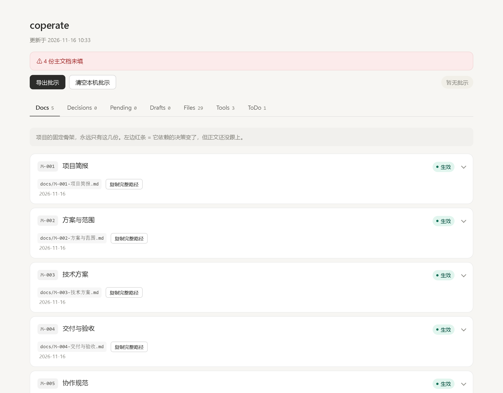
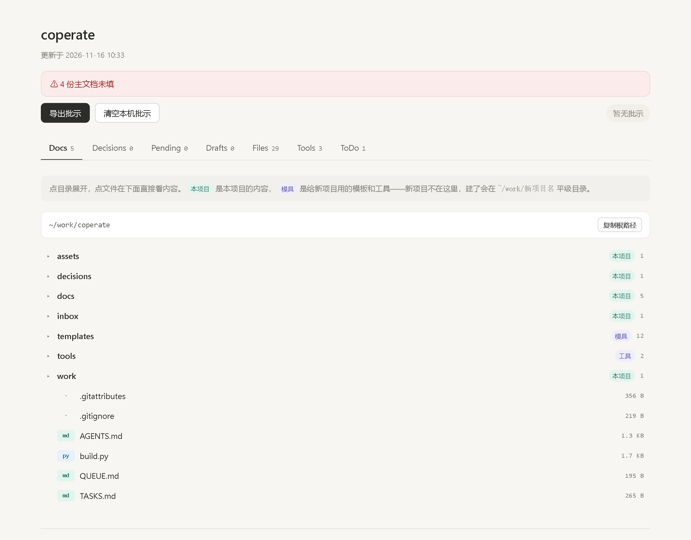

# coperate

给 AI 协作做「文档台账」的一套规范 + 工具。

一句话：AI 写文档最容易腐烂——同一件事两个说法、改了一处忘了另一处、凭印象复述旧方案。这套东西把「谁说了算、改完要做什么、哪里会静默腐烂」变成**可机械检查**的规则。



> 上图是刚生成、还没填内容的空台账。五份文档都在「待补」。

## 它解决什么

1. **同一件事两个说法** —— 决策在一处，文档在另一处，慢慢对不上
2. **改了一处忘了另一处** —— 脚本改了文档没改；文档改了模板没改
3. **凭印象复述旧方案** —— 手上明明有历史，AI 还是按记忆编一个

## 核心设计

| | |
| --- | --- |
| MD 数据层，HTML 阅读层 | 人只看页面，AI 只改 md，页面永远从 md 重新生成 |
| 决策只追加，永不改正文 | 改主意就新增一条并 `supersede` 旧的，历史不会被抹掉 |
| 每节带锚点和版本号 | 决策靠 `M-003#serve` 定位，不认中文标题；改内容必须涨版本 |
| 脚本声明服务于哪一节 | `serves` + `serves_version`，文档改版脚本必须复核 |
| 校验器机械检查 | 断链、漂移、孤儿产出、cap 重复、版本不一致，跑一遍就知道 |
| `AGENTS.md` 放在项目根 | AI 一进项目就知道该读什么、跑什么，不靠人提醒 |

## 30 秒上手

需要 Python 3.8+，只用标准库，没有第三方依赖。下面写 `python`，Linux/macOS 上可能是 `python3`。

```bash
git clone <仓库地址> 我的工作区
cd 我的工作区/coperate

python build.py        # 生成 BOARD.html
python tools/scan.py   # 校验台账
```

双击 `coperate/BOARD.html` 就能看。**刚生成时是空模板，五份文档都写着「待补」——这是正常的**，填了才有内容。

改完 md 记得再跑一次 `python build.py`，**看板不会自动刷新**。

## 看板怎么用



- **顶部导航**：Docs（主文档）/ Decisions（决策）/ Pending（待定）/ Drafts（工作稿）/ Files（文件树）/ Tools（脚本）/ ToDo（任务）
- **文档卡片**点右侧 `>` 展开，直接看渲染后的正文，不用打开编辑器
- **框选任意一段文字**，会弹出「添加到待定区」——在 Pending 页写批注，不动正文
- **导出批示**：点按钮复制一段结构化文本，粘回对话，AI 就落盘成 `D-xxx` 或 `P-xxx`
- 批注存在浏览器 localStorage，按条目 ID 归位；清缓存会丢，及时导出
- **文件页**：目录树 + 点文件直接看内容。每个文件带「复制完整路径」——浏览器打不开文件夹，这是唯一可行的定位方式

## 目录约定

```
我的工作区/                 ← clone 下来的这一层
    AGENTS.md               AI 进项目先读它
    coperate-tools/         跨项目共享的工具，只有一份
    coperate/               台账
        AGENTS.md  build.py  tools/  templates/
        docs/ decisions/ work/ inbox/ assets/
        QUEUE.md  TASKS.md  BOARD.html
    我的新项目/              再 scaffold 出来的项目，结构同上
```

项目根只有 `AGENTS.md`、`coperate/`、`<项目名>/`，台账和资产物理分开。

**`coperate/` 有两个身份**：既是模板示例，也可以直接当你的第一个项目。

- 想从零开始 → 直接填 `coperate/docs/` 里那五份
- 想起新项目 → 见下节；生成之后 `coperate/` 想删就删，它就是个示例

## 起第二个项目

```bash
cd coperate
python tools/scaffold.py ../我的新项目
```

新项目在 `我的工作区/我的新项目/`，台账在 `我的新项目/coperate/`。生成时会自动跑一次看板，并刷新工作区总入口。

## 总入口

在工作区根（`我的工作区/`）跑：

```bash
python coperate-tools/build_index.py
```

生成 `我的工作区/index.html`，扫出所有项目的 `BOARD.html`，点哪个看哪个。总入口是生成物，不维护项目清单——新项目生成时自动收录。

项目文件太多、看板太大？在 `coperate/board.conf` 里写 `tree = off`，就不扫描文件树、也不生成 Files 页（实测一份 61 文件的台账，`BOARD.html` 从 354 KB 降到 187 KB）。删掉这个文件即恢复。

## 备份（可选）

```bash
cp coperate-tools/config.example.json coperate-tools/config.json    # Windows 用 copy
# 编辑 config.json：填备份盘路径和要备份的项目
python coperate-tools/sync_backup.py --check    # 先看会写什么，不动文件
python coperate-tools/sync_backup.py            # 真备份
```

单向：本地 → 备份盘。默认不删远端文件，`--prune` 才删。

## 从哪读起

`coperate/docs/M-005-协作规范.md` 是**唯一约束 AI 行为的文件**，十二节。第一次读这三节就够：

- **§三 动手前必须列依据** —— 握手清单：AI 写文件前先把依据摆出来让人拦
- **§六 汇报格式** —— 干完活最多三行：改了什么 / 动了哪些文件 / 下一步等谁
- **§七 每次开工前** —— 先查再建，不要带着断链往上加

再往下：§五 绝对不许做的事、§八 文档与脚本同步升降、§十 结构与命名。

## AGENTS.md 是给 AI 的入口

项目根的 `AGENTS.md` 写清「读哪个文件、跑哪个命令、改完做什么」。Claude Code、Codex、Cursor、WorkBuddy 这类会读 `AGENTS.md` 的工具，一进项目就按它执行，不用每次复述规矩。

这也是它跟「一个漂亮的静态站点生成器」的区别：**它约束的是 AI 的行为，看板只是阅读层。**

## 边界

- 这是给人 + AI 共用的台账，不是文档编辑器。批注走 localStorage + 一键复制，不直写文件
- 不追求自动化一切：能机械重复的才自动，需要判断的必须等人。Pending 页就是给判断留的入口
- 单机为主：没有服务端、没有登录、没有数据库

## 许可

MIT，见 `LICENSE`。
